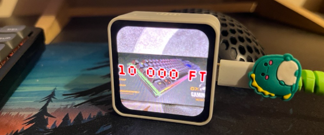

# keyboard-pic-scraper

The scraper checks the newest non-featured keyboard listing on [HardverApró](https://hardverapro.hu/aprok/hardver/billentyuzet_eger_pad/pc/billentyuzet/index.html), draws its price on the photo, and sends the result to my [ESP32](https://github.com/ZalaPanda/draw-esp) display HTTP endpoint. The receiver must accept a `POST` with a raw JPEG body (`Content-Type: image/jpeg`).



## Run locally

With Node.js 22 or newer installed, run these commands from the project directory:

```bash
npm ci
npm start
```

## How it works

The first check runs immediately. After each check, successful or not, the scraper waits `POLL_INTERVAL_MS` milliseconds (60 seconds by default). Errors are logged. Stop the loop with Ctrl+C or `docker stop scraper`.

After a successful upload, the scraper remembers the listing image URL in its process environment. An unchanged URL skips both the download and the upload, even if the price changed. After a restart, the first image is uploaded again unless you supply its listing image URL as `LAST_IMAGE_URL`.

The scraper accepts JPEG and PNG listing images. PureImage measures the price text and scales it proportionally so its width, including the white outline, matches the image's shorter side. If the text would be too tall, it scales down to fit the image height instead. The red price stays centered, and the scraper uploads the result as a JPEG at quality 90. The `slkscr.ttf` font is bundled; no system font installation is required.

## Run with Docker

```bash
docker run -d --name scraper ghcr.io/zalapanda/keyboard-pic-scraper:latest
```

The default upload URL is `http://esp32-display.local/api/image?fit=cover`. If the container cannot resolve that hostname, set `UPLOAD_URL` to an address it can reach. Pass the override with `-e UPLOAD_URL=...` before the image name, or use Compose.

## Run with Docker Compose

Save this as `compose.yaml`, adjust the receiver address if needed, and run `docker compose up -d` from the same directory:

```yaml
services:
  scraper:
    image: ghcr.io/zalapanda/keyboard-pic-scraper:latest
    environment:
      UPLOAD_URL: "http://esp32-display.local/api/image?fit=cover"
      POLL_INTERVAL_MS: "60000"
```
